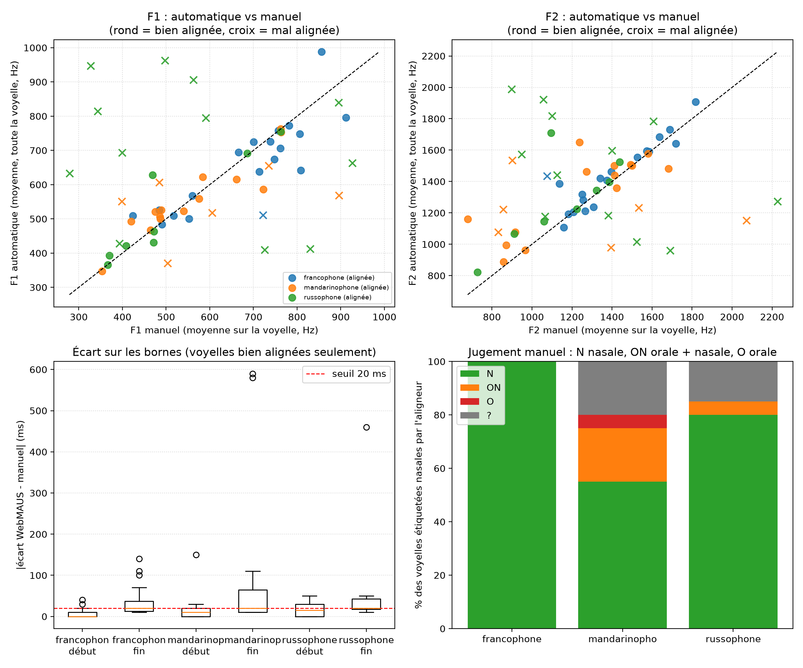
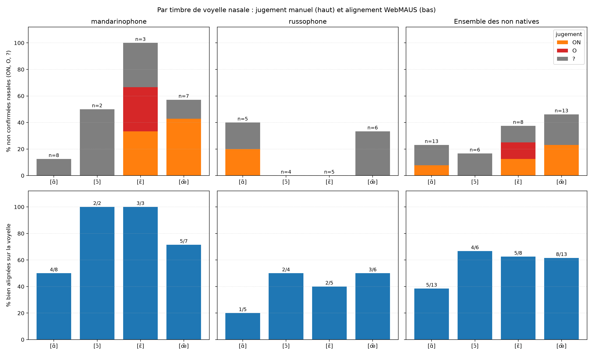

# Voyelles nasales du français chez deux locutrices non natives : validation manuelle d'une chaîne d'analyse automatique

> Projet exploratoire, né d'une curiosité personnelle, qui réutilise des enregistrements issus d'un projet de Master 1 (voir « Données »).
> Il s'agit d'une **étude pilote** : elle porte sur trois locutrices et 60 voyelles annotées, et n'autorise aucune généralisation à des langues.

## Objectif

Ma question de départ était : **Comment des locutrices de langue maternelle russe ou mandarin produisent-elles les voyelles nasales du français, par rapport à une locutrice native ?**

Le choix de se focaliser sur les voyelles nasales se justifie par les différences entre le système vocalique du français et ceux du russe et du mandarin. En russe, les voyelles nasales ne constituent pas des phonèmes indépendants, même si une nasalisation phonétique peut apparaître au contact de consonnes nasales (Solonina, E. G., 2018). En mandarin standard, les rimes syllabiques peuvent comporter une voyelle suivie d'une coda nasale /n/ ou /ŋ/. La voyelle précédente peut également subir une nasalisation par coarticulation, sans que cela implique l'existence de voyelles nasales phonémiques comparables à celles du français (Li, 2008 ; Luo et al. , 2020).

Ces différences entre les systèmes phonologiques constituent un point de départ pertinent pour examiner les modalités de production des voyelles nasales françaises chez les locutrices russophones et sinophones, notamment en comparaison avec une locutrice native.

Avant de comparer des mesures acoustiques (F1 et F2) entre locutrices, j'ai voulu vérifier que les outils automatiques que j'utilise sont fiables sur ces enregistrements. J'ai donc refait à la main une partie du travail sur un échantillon de voyelles nasales, et j'ai comparé mes annotations à celles de la machine. Ce dépôt documente cette validation : les scripts, le protocole et les résultats.

Trois questions guident la comparaison :

1. **L'alignement** : WebMAUS place-t-il son intervalle sur la bonne voyelle, et avec quelle précision ?
2. **Les formants** : les F1 et F2 mesurés automatiquement sont-ils proches des miens ?
3. **La nature de la voyelle** : parmi les voyelles que l'aligneur étiquette « nasales », combien le sont réellement à l'oreille ?

## Transparence sur l'usage de l'IA

Les scripts (Python et Praat) ont été corrigés et implémentés avec l'appui de **Claude AI (Anthropic)**.

## Données

| Locutrice | Langue maternelle | Enregistrement | Durée |
| --- | --- | --- | --- |
| `francophone` | français | lecture d'un livre à voix haute, enregistrement récupéré sur YouTube et coupé car trop long | 3 min 32 s |
| `russophone` | russe | tâche d'itinéraire en français (voir ci-dessous) | environ 8 min |
| `mandarinophone` | mandarin | tâche d'itinéraire en français (voir ci-dessous) | environ 6 min |

Le plafond de formants de 5500 Hz utilisé pour toutes les locutrices convient à des voix féminines.

**Enregistrements des locutrices non natives.** Ce sont ceux de deux camarades, réalisés dans le cadre d'un projet de Master 1. Ce projet vise à analyser la production des sons du français chez des locuteurs non natifs, en particulier de phonèmes absents de leurs langues maternelles, et à constituer un corpus qui pourrait servir aux technologies de traitement automatique de la parole (agents conversationnels, systèmes de transcription).


Pour chaque enregistrement, je dispose d'une transcription automatique (Tadddam) et d'un alignement automatique avec WebMAUS.

**Ce que contient le dépôt.** Les **enregistrements audio, les TextGrid (transcription et alignement) ne sont pas diffusés**, faute de droits de diffusion. Tout le reste l'est : ma feuille d'annotation, les valeurs automatiques et les résultats.

## Méthode

### 1. Extraction automatique des voyelles

Le script `scripts/extraction_voyelles.praat` lit l'enregistrement et son TextGrid WebMAUS (tiers `ORT-MAU`, `KAN-MAU`, `MAU`) et extrait, pour chaque voyelle orale (`a e E i o O u y 2 9`) ou nasale (`a~ e~ o~ 9~`) : le mot, la durée, le contexte, F1, F2 et la f0.
 
- Formants : algorithme de Burg de Praat, plafond de 5500 Hz, 5 formants, fenêtre de 25 ms.
- `f1` et `f2` sont pris au milieu de la voyelle ; `f1Moy` et `f2Moy` sont moyennés sur sa moitié centrale. C'est `f1Moy` et `f2Moy` que je compare à mon annotation (voir « Comparaison »).
- Une voyelle est marquée « exploitable » si elle dure au moins 40 ms et si F1 et F2 sont mesurés.
### 2. Échantillon et annotation manuelle
 
Le script `scripts/tirage_echantillon.py` tire au hasard 20 voyelles nasales par locutrice (60 au total ; au moins 2 par timbre quand c'est possible). Le tirage est reproductible car valeur de la graine utilisée est fixée à`42` par défaut.
 
La feuille d'annotation ne contient **aucune valeur automatique** : seulement le mot et ses bornes, pour retrouver la voyelle. J'ai ouvert l'enregistrement et le TextGrid dans Praat et, pour chaque voyelle, noté :
 
| Tâche | Ce que je note |
| --- | --- |
| Nature | `N` voyelle nasale ; `ON` voyelle orale suivie d'une consonne nasale ; `O` voyelle orale ; `?` indécidable |
| Bornes | début et fin de la voyelle (en secondes) |
| Formants | F1 et F2 (en Hz), relevés avec Praat en gardant la voyelle sélectionnée du début à la fin : c'est une **moyenne sur toute la voyelle** |
 
Le protocole détaillé (critères, menus de Praat) est dans `docs/protocole_annotation.md`.
 
### 3. Comparaison
 
Le script `scripts/comparer_manuel_auto.py` associe mes annotations aux valeurs de la machine et calcule :
 
| Indicateur | Définition |
| --- | --- |
| **Bien alignée** | le milieu de ma voyelle tombe dans l'intervalle posé par WebMAUS. Sinon, la machine a mesuré un autre son : ses bornes et ses formants n'ont alors pas de sens. |
| **Écart de bornes** | pour les voyelles bien alignées, écart absolu (ms) entre mes bornes et celles de WebMAUS ; part des voyelles dont les deux bornes sont à 20 ms ou moins |
| **Écart de formants** | pour les voyelles bien alignées, erreur absolue moyenne (Hz) sur F1 et F2 entre ma moyenne sur toute la voyelle et la moyenne automatique sur la moitié centrale de la voyelle de WebMAUS (`f1Moy`, `f2Moy`) ; part des mesures à moins de 100 Hz (F1) ou 200 Hz (F2) |
| **Nature** | répartition `N` / `ON` / `O` / `?` des voyelles étiquetées nasales par l'aligneur |
| **Problèmes signalés** | voyelles dont mon commentaire mentionne un problème d'alignement ou de transcription (détection par mots-clés, à relire) |
 
 
## Résultats
 
### Les locutrices entre elles
 
| | Francophone | Mandarinophone | Russophone | Non natives (ensemble) |
| --- | --- | --- | --- | --- |
| Voyelles annotées | 20 | 20 | 20 | 40 |
| Bien alignées sur la voyelle | 18/19 (94,7 %) | 14/20 (70,0 %) | 8/20 (40,0 %) | 22/40 (55,0 %) |
| Jugées nasales (`N`) | 20 (100 %) | 11 (55,0 %) | 16 (80,0 %) | 27 (67,5 %) |
| `ON` / `O` / `?` | 0 / 0 / 0 | 4 / 1 / 4 | 1 / 0 / 3 | 5 / 1 / 7 |
| Écart de bornes médian (bien alignées) | 10 ms | 10 ms | 20 ms | 20 ms |
| Deux bornes à 20 ms ou moins (bien alignées) | 44,4 % | 35,7 % | 25,0 % | 31,8 % |
| Erreur moyenne F1 (bien alignées) | 53 Hz | 33 Hz | 32 Hz | 33 Hz |
| Erreur moyenne F2 (bien alignées) | 57 Hz | 129 Hz | 133 Hz | 130 Hz |
| F1 à 100 Hz ou moins | 83,3 % | 92,9 % | 87,5 % | 90,9 % |
| F2 à 200 Hz ou moins | 94,4 % | 85,7 % | 87,5 % | 86,4 % |
| Commentaire signalant un problème d'alignement | 1 | 4 | 12 | 16 |
| Commentaire signalant un problème de transcription | 1 | 5 | 2 | 7 |
 
Une voyelle de la francophone n'a pas de mesure manuelle et n'est pas évaluable pour l'alignement. Les formants portent sur 18, 14, 8 et 22 voyelles.
 

 
*Haut : F1 et F2 automatiques contre manuels (rond : bien alignée ; croix : mal alignée). Bas gauche : écart des bornes (voyelles bien alignées). Bas droite : jugement manuel de la nature.*
 
### Par timbre (locutrices non natives, ensemble)
 
| Voyelle | n | `N` | `ON` | `O` | `?` | Non confirmées nasales | Bien alignées |
| --- | --- | --- | --- | --- | --- | --- | --- |
| [ɑ̃] | 13 | 10 | 1 | 0 | 2 | 3/13 (23,1 %) | 5/13 (38,5 %) |
| [ɔ̃] | 6 | 5 | 0 | 0 | 1 | 1/6 (16,7 %) | 4/6 (66,7 %) |
| [ɛ̃] | 8 | 5 | 1 | 1 | 1 | 3/8 (37,5 %) | 5/8 (62,5 %) |
| [œ̃] | 13 | 7 | 3 | 0 | 3 | 6/13 (46,2 %) | 8/13 (61,5 %) |
 

 
Les tableaux complets et le détail voyelle par voyelle sont dans `resultats/`.
 
 
### Ce que j'en retiens
 
- **L'alignement est le principal point faible.** Treize voyelles sur 60 sont placées par WebMAUS à plus d'une seconde de la voyelle réelle (11 chez la russophone, 2 chez la mandarinophone, aucune chez la francophone). Seules 55,0 % des voyelles des non natives sont bien alignées, contre 94,7 % pour la locutrice native.
- **Quand l'alignement est correct, les mesures sont assez proches des miennes.** L'écart de bornes médian est de 10 à 20 ms, mais seulement 25 à 44 % des voyelles ont leurs deux bornes à 20 ms ou moins. Comparés à ma moyenne sur toute la voyelle, les formants automatiques s'écartent en moyenne de 33 à 77 Hz pour F1 et de 91 à 140 Hz pour F2 ; 62 à 93 % des mesures de F1 et 79 à 89 % de celles de F2 sont dans les seuils. Je ne vois pas d'erreur systématiquement plus forte chez les non natives. L'erreur de F1 la plus élevée est celle de la francophone, tirée surtout par une voyelle (« un » : 1204 Hz automatique contre 856 Hz à la main). L'erreur de F2 la plus élevée est celle de la russophone, due à une seule voyelle (« point » : 1882 Hz contre 1096 Hz) : sans elle, l'erreur moyenne de F2 de la russophone serait d'environ 48 Hz. Avec 8 à 18 voyelles par locutrice, une seule mesure déplace beaucoup la moyenne.
- **Tous les jugements `N` ne se valent pas.** La francophone a 20 voyelles sur 20 jugées nasales, contre 11 sur 20 pour la mandarinophone et 16 sur 20 pour la russophone. Six des sept `?` sont accompagnés d'un commentaire signalant une erreur d'alignement ou de transcription : l'indécision porte souvent sur le signal ou l'alignement avant de porter sur la nasalité.
- **Par timbre**, [œ̃] est la voyelle le plus souvent non confirmée nasale (6 sur 13) et [ɔ̃] la moins souvent (1 sur 6). [ɑ̃] est la moins bien alignée (5 sur 13), mais c'est surtout dû à la russophone (1 voyelle sur 5 bien alignée), donc à un effet de locutrice plus que de timbre.
- **Conséquence pour la suite** : toute comparaison acoustique entre ces locutrices devrait d'abord corriger l'alignement, ou ne garder que les voyelles vérifiées.
 
## Limites
 
- **Échantillon très petit** : 20 voyelles par locutrice, et seulement 6 à 13 par timbre pour les non natives. Les écarts entre timbres ou entre locutrices ne sont pas établis statistiquement.
- **Une locutrice par langue** : je décris trois personnes, pas des langues.
- **Enregistrements non comparables** : une lecture de livre (parole lue, récupérée sur YouTube) d'un côté, une tâche d'itinéraire spontanée de l'autre, avec des qualités d'enregistrement différentes. Je ne peux pas attribuer les différences d'alignement à la langue maternelle.
- **Une seule personne a annoté** : le jugement de nature (`N`, `ON`, `O`) est subjectif et n'a pas été vérifié par une seconde personne.
- **Le timbre de la voyelle** (/ɑ̃/, /ɔ̃/, /ɛ̃/, /œ̃/) est celui que WebMAUS attend dans le mot d'après son dictionnaire, pas celui que j'ai vérifié. Il diffère de la forme canonique du mot dans 3 cas sur 60, mais une erreur de transcription peut aussi faire annoter la mauvaise voyelle.
- **Mes débuts de voyelle coïncident avec ceux de WebMAUS (à 5 ms près)** dans 10 cas sur 20 pour la francophone, 6 pour la mandarinophone et 3 pour la russophone. C'est plausible si l'alignement est précis, mais cela peut surestimer la précision des bornes si j'avais vu les bornes de WebMAUS.
- **Plafond de formants unique** (5500 Hz) pour les trois locutrices, sans réglage par locutrice.
- **Les problèmes signalés** sont repérés par recherche de mots-clés dans mes commentaires et peuvent comporter des erreurs.
 
 
## Structure du dépôt
 
```
.
├── README.md                     ce document
├── requirements.txt              bibliothèques Python
├── .gitignore                   
├── scripts/
│   ├── extraction_voyelles.praat     extraction des voyelles et des formants (Praat)
│   ├── tirage_echantillon.py         tirage de l'échantillon à annoter
│   └── comparer_manuel_auto.py       comparaison manuel / automatique
│   
├── docs/
│   └── protocole_annotation.md       protocole d'annotation manuelle
├── donnees/                    feuille annotée, valeurs automatiques
└── resultats/                    tableaux (csv, xlsx), détail et figures
```
 
## Reproduire l'analyse
 
Python 3.10 ou plus :
 
```bash
python -m venv .venv
source .venv/bin/activate        # Windows (PowerShell) : .venv\Scripts\Activate.ps1
pip install -r requirements.txt
python scripts/comparer_manuel_auto.py
```
 
Cette commande régénère les tableaux et les figures de `resultats/` à partir de `donnees/`. L'option `--reference` indique la locutrice native (`francophone` par défaut).
 
Pour appliquer la chaîne à d'autres enregistrements alignés avec WebMAUS (français, étiquettes SAMPA `a~ e~ o~ 9~`), avec Praat 6 ou plus récent et `<nom>.wav` et `<nom>.TextGrid` dans `donnees/` :
 
1. exécuter `scripts/extraction_voyelles.praat` dans Praat, une fois par locuteur (champ `nom`) ;
2. `python scripts/tirage_echantillon.py --n 20` ;
3. annoter la feuille selon `docs/protocole_annotation.md` ;
4. `python scripts/comparer_manuel_auto.py`.

## Outils et références

 
- Alignement : WebMAUS. Kisler, T., Reichel, U. et Schiel, F. (2017), « Multilingual processing of speech via web services », *Computer Speech & Language*, 45, p. 326-347.
- Analyse acoustique : Praat. Boersma, P. et Weenink, D., *Praat: doing phonetics by computer*, <https://www.praat.org>. Le script d'extraction est adapté d'un script de cours (linguistique du corpus, 2024, L3 SDL, UNICAEN).
- Python : pandas, numpy, matplotlib, openpyxl.
- Excel
- Claude AI (Anthropic)
- Li, Y. (2008). An acoustically based contrastive study of L1 and L2 nasal coda production. In Proceedings of the 2008 Annual Conference of the Canadian Linguistic Association.
- Luo, M., Van de Weijer, J., & Sloos, M. (2020). “A perceptually-based OT approach to opacity in Mandarin Chinese nasal rhymes.” In D. Chen & D. Bell (Eds.), Explorations of Chinese Theoretical and Applied Linguistics (pp. 8–43). Cambridge Scholars Publishing
- Solonina, E. G. (2018). « Акустические и перцептивные признаки коартикуляционной назализации гласных в русском языке » [Caractéristiques acoustiques et perceptives de la nasalisation coarticulatoire des voyelles en russe]. Speech Technology / Речьевые технологии, 2018(2).
